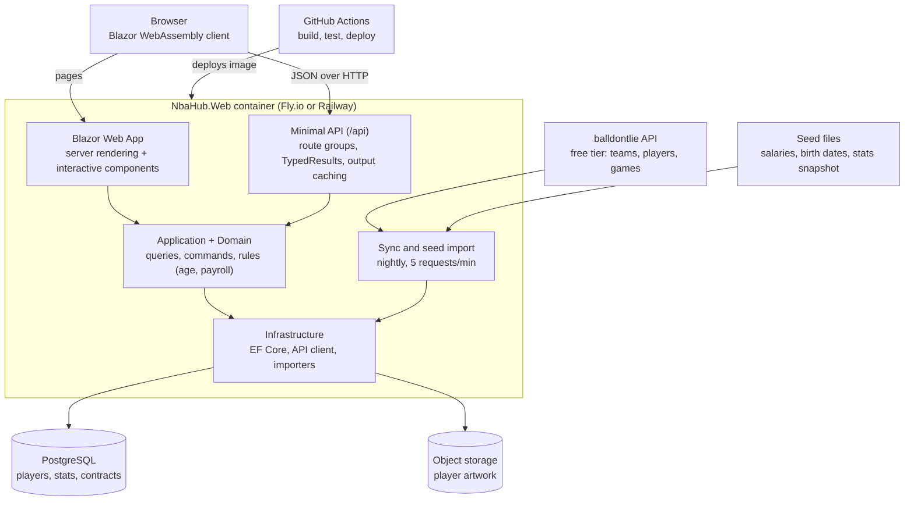

# NBA Player Hub – Technical Design

_Last updated: 30 Oct 2026_

Version 1 is a single deployable ASP.NET Core app (Blazor Web App plus minimal API) backed by PostgreSQL, with player data synced from an external API and salaries seeded from files I maintain.

## Architecture

One container serves pages and the API; outside data arrives only by sync.

Only the sync worker talks to balldontlie, so a slow or down external API never slows a page.

## Solution structure

One solution (`NbaHub.slnx`), six source projects plus test projects. Dependencies point inward: Domain depends on nothing, and Infrastructure is the only project that knows about EF Core, HTTP or storage.

| Project | Owns | References |
| --- | --- | --- |
| `NbaHub.Domain` | Entities, value objects (Money, Height), rules such as age and team payroll | Nothing |
| `NbaHub.Contracts` | DTO records shared by the API and the Blazor client | Nothing |
| `NbaHub.Application` | Queries and commands, interfaces such as `IPlayerDataProvider` and `IArtStorage` | Domain, Contracts |
| `NbaHub.Infrastructure` | EF Core `DbContext` and migrations, balldontlie client, seed importers, art storage | Application |
| `NbaHub.Web` | Host: Blazor server side, minimal API endpoints, background sync, DI wiring | All of the above |
| `NbaHub.Web.Client` | Interactive WebAssembly components that call the API over `HttpClient` (not created yet) | Contracts |
| `tests/*` | Domain, Application, API integration and component tests | The project under test |

**Trade-off:** four layers is more ceremony than a small app strictly needs. It's worth it here because interviewers often ask about separation of concerns, and it lets the trade machine slot in later as a new set of Application features.

**Optional extra:** a .NET Aspire AppHost to start Postgres and the app together locally with one command.

## Data model

Seven tables in PostgreSQL. Every synced row keeps the source's ID in `ExternalId`, so the nightly sync can upsert instead of duplicating.

| Entity | Key fields | Relationships |
| --- | --- | --- |
| Team | Id, ExternalId, City, Name, Abbreviation, Conference, Division, PrimaryColour | Has many Players |
| Player | Id, ExternalId, Slug, FirstName, LastName, Position, HeightInches, WeightLbs, JerseyNumber, College, Country, DraftYear, DraftRound, DraftPick, BirthDate, IsActive | Belongs to Team; has many SeasonStats, Contracts, Artworks |
| PlayerSeasonStats | PlayerId, Season, GamesPlayed, Minutes, Points, Rebounds, Assists, Steals, Blocks, FgPct, Fg3Pct, FtPct | Belongs to Player; unique on (PlayerId, Season) |
| Contract | Id, PlayerId, TeamId, StartSeason, EndSeason, TotalValue, SourceNote | Belongs to Player and Team; has many ContractYears |
| ContractYear | ContractId, Season, Salary, OptionType (none, player, team), IsGuaranteed | Belongs to Contract |
| Artwork | Id, PlayerId, ImageUrl, ThumbnailUrl, AltText, IsPrimary, Width, Height, UploadedAt | Belongs to Player |
| SyncRun | Id, Source, StartedAt, FinishedAt, Status, RecordsUpdated, Error | None (audit log) |

**Design notes:**

- Money is stored as `decimal` in whole US dollars and wrapped in a `Money` value object in the domain.
- Team payroll is calculated (sum of ContractYear salaries for the season), not stored, so it can't drift.
- Splitting Contract and ContractYear now is what makes the trade machine possible later, since cap rules work on a single season's salary.
- BirthDate is seeded, because the balldontlie player record has no birth date field and age needs one.

## Data sources and sync

balldontlie's free tier covers bio data but not stats or contracts, so version 1 combines the free API with files I maintain. The app never calls balldontlie during a page request; it reads only from its own database.

**What each balldontlie tier unlocks (NBA), as of Oct 2026:**

| Tier | Price (USD/month) | Rate limit | Adds |
| --- | --- | --- | --- |
| Free | 0 | 5 requests/min | Teams, players, games |
| ALL-STAR | 9.99 | 60 requests/min | Per-game player stats, active players, injuries |
| GOAT | 39.99 | 600 requests/min | Season averages, standings, contracts, shot charts and more |

Source: [balldontlie docs](https://docs.balldontlie.io/).

**Where each piece of version 1 data comes from:**

| Data | Source | Refresh |
| --- | --- | --- |
| Teams | balldontlie `/teams` (free) | Weekly sync |
| Player bio and current team | balldontlie `/players` (free), for a curated list of player IDs | Nightly sync |
| Birth date and active flag | `seed/players.json`, maintained by me | When I add a player |
| Season stats | `seed/stats-2026-27.csv` snapshot for the thin slice | Manually, a few times a season |
| Contracts and salaries | `seed/contracts.csv`, maintained by me | When contracts change |
| Artwork | My uploads through the admin page | Ongoing |

**Sync design:**

- A `BackgroundService` runs the nightly sync. It can also be triggered from the admin API.
- A typed `HttpClient` uses `Microsoft.Extensions.Http.Resilience` for retries and a rate limiter held at 5 requests a minute.
- Requests use `per_page=100` and cursor pagination to keep the call count low.
- Results are upserted by `ExternalId`, and every run writes a `SyncRun` row.
- Everything sits behind `IPlayerDataProvider`, so switching to another source (or to ALL-STAR stats) is an Infrastructure change only.

**Upgrade path for stats:** ALL-STAR adds per-game stats. Computing season averages from those games is good, testable domain logic.

## API endpoints (version 1)

Minimal API route groups under `/api`, returning `TypedResults` and documented with built-in OpenAPI. Admin routes need authentication; everything else is public and read-only.

| Method | Route | Purpose |
| --- | --- | --- |
| GET | `/api/players?team=&position=&search=&page=` | Gallery list with filters and paging |
| GET | `/api/players/{slug}` | Profile: bio, current stats, contract, primary art |
| GET | `/api/teams` | All teams |
| GET | `/api/teams/{abbreviation}` | Team roster with art and season payroll |
| POST | `/api/admin/players/{id}/artwork` | Upload art for a player (admin) |
| DELETE | `/api/admin/artwork/{id}` | Remove an artwork (admin) |
| POST | `/api/admin/sync` | Run the data sync now (admin) |
| GET | `/health` | Health check for the host |

**Admin auth:** a single admin account using cookie authentication, with credentials from configuration secrets. Full ASP.NET Core Identity would be overkill until public accounts arrive with the trading cards module.

**Caching:** output caching on the public GET routes, cleared when a sync or upload finishes.

## Testing strategy

Test the logic that would embarrass me if it broke, not a coverage percentage. Everything runs in CI on every push.

| Layer | Tool | What it covers |
| --- | --- | --- |
| Domain unit tests | xUnit + Shouldly | Age from birth date, height formatting, payroll totals, contract-year rules |
| Application tests | xUnit + fakes | Query filtering and paging, seed import validation, sync upsert logic |
| Data client tests | xUnit + fake `HttpMessageHandler` + saved JSON fixtures | Mapping balldontlie responses, pagination, handling 429 responses |
| API integration tests | `WebApplicationFactory` + Testcontainers PostgreSQL | Endpoints end to end against a real database, including migrations |
| Component tests | bUnit | Gallery card and profile page render the right data |
| End-to-end (later) | Playwright | One smoke test against the deployed site |

**Why Shouldly:** FluentAssertions moved to a paid licence for commercial use from version 8.

## CI/CD and deployment

Target **.NET 10 (LTS)**, supported until 14 November 2028. .NET 9 reaches end of support on 10 November 2026 ([.NET support policy](https://dotnet.microsoft.com/en-us/platform/support/policy/dotnet-core)).

**Pull request pipeline (GitHub Actions):**

1. Restore and build with warnings as errors.
2. Check formatting with `dotnet format --verify-no-changes` (to add).
3. Run all tests, including Testcontainers integration tests once the database exists.
4. Upload test results.

**Main branch pipeline (to add with the first deploy):**

1. Everything above.
2. Build a container image with `dotnet publish /t:PublishContainer`.
3. Run EF Core migrations using a migrations bundle as a separate step.
4. Deploy the image to Fly.io or Railway.
5. Smoke test `/health` on the live URL.

**Configuration and secrets:** the balldontlie API key, database connection string and admin credentials live in GitHub Actions secrets and the host's secret store, never in the repo. Locally they live in `dotnet user-secrets`.

## Key decisions

See [`docs/adr`](adr/) for the full records.

## Risks and open questions

| Risk | Impact | Mitigation |
| --- | --- | --- |
| Free tier is capped at 5 requests a minute | Slow syncs | Sync nightly, curated player list, `per_page=100`, never call the API per page view |
| No stats or contracts on the free tier | Profile pages feel thin | Seeded files for version 1; ALL-STAR as the upgrade path |
| balldontlie changes its tiers or pricing | Sync breaks | `IPlayerDataProvider` abstraction and saved JSON fixtures in tests |
| Auto render mode complexity | Bugs that only show on server or only in the browser | Keep interactive components few; test both modes |
| Art takes longer than coding | Gallery looks empty | Placeholder silhouettes; 5 players in the thin slice, 30 by MVP |
| Seeded salary data goes stale | Wrong numbers on screen | Show a "data as of" date on every salary section |

**Open questions:**

- [ ] Stats for version 1: seeded snapshot only, or pay for ALL-STAR from the start?
- [ ] Fly.io or Railway, after comparing current pricing and Postgres options?
- [ ] Which object storage for art?
- [ ] Final app name.
